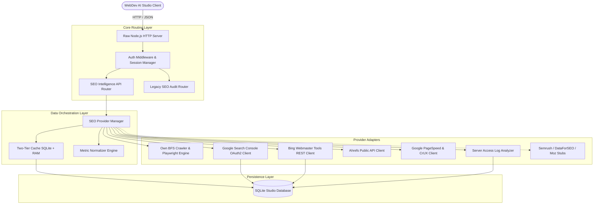

# Architecture Specification: SEO Intelligence Platform

This document describes the architectural design, security boundaries, and data pipelines of the **WebDev AI Studio SEO Intelligence Platform**.

---

## 1. System Overview & Core Philosophy

The SEO Intelligence Platform transforms WebDev AI Studio into an enterprise-grade search intelligence suite inspired by tools like SEMrush and Ahrefs, governed by one fundamental rule:

> **Zero Fake Data**: Every metric, ranking, status code, and speed index shown in the interface originates from an authentic crawl, actual HTTP response, parsed HTML, headless browser measurement, or official third-party API. If a service is unconnected, unsupported, or has insufficient data (e.g. low-traffic CrUX field data), the system explicitly reports "Unavailable" or "Not Connected" rather than generating synthetic or placeholder numbers.



---

## 2. Component Breakdown

### 2.1 API Routing Layer (`server/routes/seo-intelligence-api.js`)
- Runs natively on raw Node.js `http.createServer` (no Express dependency).
- Protects all endpoints with `requireAuth(req, res)` middleware using 7-day cryptographically secure cookie sessions (`studio_session`).
- Provides unified endpoints for:
  - Provider registry and real-time connectivity status
  - Google Search Console OAuth2 initialization, token exchange, and query reporting
  - Bing Webmaster API key configuration and site traffic stats
  - Ahrefs Free Public API Domain Rating lookups
  - Google PageSpeed Insights & CrUX field data
  - Domain overview aggregation and competitor gap comparisons
  - Server access log parsing and crawl budget waste diagnostics

### 2.2 Provider Coordinator & Normalizer (`server/services/seo/`)
- **`seo-provider-manager.js`**: Coordinates asynchronous queries across all connected data providers. Performs graceful degradation when an optional provider is unconfigured.
- **`seo-normalizer.js`**: Enforces a strict uniform metric contract across all providers:
  ```json
  {
    "value": 85,
    "source": "pagespeed",
    "sourceLabel": "Google PageSpeed Insights",
    "fetchedAt": "2026-09-18T13:40:00.000Z",
    "status": "fresh",
    "available": true,
    "methodology": "Lighthouse v12 mobile lab performance score",
    "limitations": null
  }
  ```
- **`seo-cache.js`**: Two-tier caching system combining in-memory TTL maps with persistent SQLite storage in table `seo_provider_cache`. Supports granular invalidation by provider or domain.

### 2.3 Provider Adapters (`server/services/seo/providers/`)
1. **Own Crawler Adapter (`providers/own-crawler/`)**:
   - Wraps the existing recursive BFS crawler, Playwright headless Chromium renderer, and deterministic 32-rule issue detection engine.
2. **Google Search Console (`providers/google-search-console/`)**:
   - Implements Google OAuth 2.0 with read-only webmasters scope (`https://www.googleapis.com/auth/webmasters.readonly`).
   - Automatically refreshes expired access tokens using secure refresh tokens stored per-user.
   - Queries Google Search Analytics API across dates (7d, 28d, 3m, 6m, 12m) and dimensions (query, page, country, device).
3. **Bing Webmaster Tools (`providers/bing-webmaster/`)**:
   - Direct REST/JSON client connecting to `https://ssl.bing.com/webmaster/api.svc/json/`.
   - Fetches verified site lists, query performance, impressions, clicks, and crawl diagnostics.
4. **Ahrefs Public API (`providers/ahrefs/`)**:
   - Connects to official Ahrefs Free Public API.
   - Delivers Ahrefs Domain Rating (DR) with strict attribution: `Domain Rating by Ahrefs`.
5. **Google PageSpeed Insights (`providers/pagespeed/`)**:
   - Queries Google PageSpeed Insights v5 API for Mobile and Desktop strategies.
   - Strictly separates Lighthouse synthetic lab scores (0-100) from Chrome User Experience Report (CrUX) 28-day real-user field data (LCP, FID/INP, CLS, FCP).
6. **Server Access Log Analyzer (`services/seo/log-analyzer.js`)**:
   - Streams and parses Common and Combined log formats (Apache/Nginx).
   - Classifies search engine bots (Googlebot Mobile/Desktop, Bingbot) and AI bots (GPTBot, ClaudeBot, PerplexityBot, ByteSpider).
   - Computes crawl budget waste by tracking 4xx/5xx responses served to search bots.

---

## 3. Database Schema

The SQLite schema (`server/data/database.js`) incorporates user-isolated tables for providers, metrics, and logs:

```sql
-- Provider Credentials & Connection State
CREATE TABLE IF NOT EXISTS seo_provider_connections (
  id TEXT PRIMARY KEY,
  user_id TEXT NOT NULL REFERENCES users(id) ON DELETE CASCADE,
  provider_id TEXT NOT NULL,
  auth_type TEXT NOT NULL,
  access_token TEXT,
  refresh_token TEXT,
  token_expires_at TEXT,
  api_key TEXT,
  account_email TEXT,
  status TEXT DEFAULT 'connected',
  metadata_json TEXT DEFAULT '{}',
  created_at TEXT DEFAULT (datetime('now')),
  updated_at TEXT DEFAULT (datetime('now')),
  UNIQUE(user_id, provider_id)
);

-- Search Console Verified Properties
CREATE TABLE IF NOT EXISTS seo_provider_properties (
  id TEXT PRIMARY KEY,
  connection_id TEXT NOT NULL REFERENCES seo_provider_connections(id) ON DELETE CASCADE,
  user_id TEXT NOT NULL REFERENCES users(id) ON DELETE CASCADE,
  property_id TEXT NOT NULL,
  site_url TEXT NOT NULL,
  permission_level TEXT,
  is_selected INTEGER DEFAULT 0,
  last_synced_at TEXT,
  created_at TEXT DEFAULT (datetime('now')),
  UNIQUE(user_id, property_id)
);

-- Search Console Daily Query Snapshots
CREATE TABLE IF NOT EXISTS seo_search_console_metrics (
  id TEXT PRIMARY KEY,
  user_id TEXT NOT NULL REFERENCES users(id) ON DELETE CASCADE,
  property_id TEXT NOT NULL,
  date TEXT NOT NULL,
  query TEXT,
  page TEXT,
  country TEXT,
  device TEXT,
  clicks INTEGER DEFAULT 0,
  impressions INTEGER DEFAULT 0,
  ctr REAL DEFAULT 0.0,
  position REAL DEFAULT 0.0,
  created_at TEXT DEFAULT (datetime('now'))
);

-- Provider Cache
CREATE TABLE IF NOT EXISTS seo_provider_cache (
  cache_key TEXT PRIMARY KEY,
  provider_id TEXT NOT NULL,
  resource_type TEXT NOT NULL,
  data_json TEXT NOT NULL,
  expires_at TEXT NOT NULL,
  created_at TEXT DEFAULT (datetime('now'))
);

-- Server Log Analyses
CREATE TABLE IF NOT EXISTS seo_log_analyses (
  id TEXT PRIMARY KEY,
  user_id TEXT NOT NULL REFERENCES users(id) ON DELETE CASCADE,
  filename TEXT NOT NULL,
  file_size_bytes INTEGER DEFAULT 0,
  lines_parsed INTEGER DEFAULT 0,
  summary_json TEXT NOT NULL DEFAULT '{}',
  created_at TEXT DEFAULT (datetime('now'))
);

-- Competitor Tracking Relations
CREATE TABLE IF NOT EXISTS seo_competitors (
  id TEXT PRIMARY KEY,
  user_id TEXT NOT NULL REFERENCES users(id) ON DELETE CASCADE,
  target_domain TEXT NOT NULL,
  competitor_domain TEXT NOT NULL,
  notes TEXT DEFAULT '',
  created_at TEXT DEFAULT (datetime('now'))
);
```

---

## 4. Security & Privacy Safeguards
1. **User Isolation**: All queries enforce `WHERE user_id = ?`. Users cannot read another user's provider tokens, crawl logs, or verified search properties.
2. **Server-Side Secret Management**: API keys and OAuth tokens are never leaked to client responses. Frontend API calls receive `{ connected: true, status: 'available' }` without raw tokens.
3. **Encrypted HTTPS Outbound**: All third-party communication uses standard Node.js `https` module with strict TLS verification.
